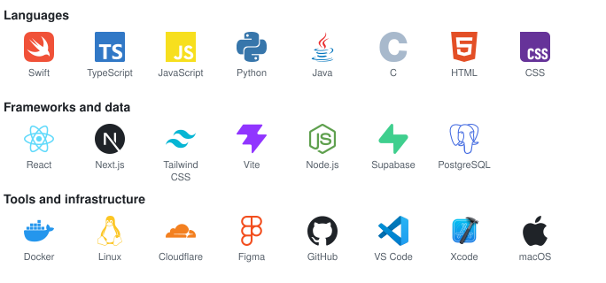

# Jacob Berggren

**Product Engineer, from UX/UI to backend and system architecture**

---

## About

I study for a Master of Science in Engineering in Interaction Technology and Design at Umeå University, graduating in 2028. The programme combines software development, system design and user centered design. I build digital products from idea to working result, and I care about both how they look and how they work.

Based in Umeå, Sweden.

## Right now

- Building **Shapeshift**, a macOS app for converting and editing files
- Building **Convert** and **Krök1**, two iOS apps in Swift
- Studying full stack development, human computer interaction and UX/UI

## Tools

## Contact

